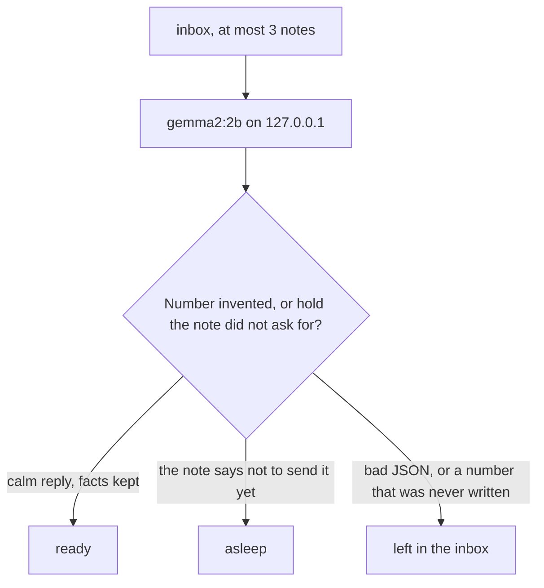

*This is a submission for the [Hacktoberfest Open-Source AI Challenge Week 3: Slow and Steady](https://dev.to/challenges/hacktoberfest-week3-2026-10-19).*

The note is already written. It is the angry one, and it is sitting there because sending it would make things worse. Mumblebox asks a local Gemma model for a calmer version, writes that into a folder, and stops after three notes. It does not send the message.

The samples in the repo are made up. They are not anyone's mail.

A file sorter for this week's theme already exists. [Dhruv Jani's slothd](https://dev.to/dj29/i-built-slothd-a-local-first-offline-capable-ai-daemon-that-patiently-organizes-your-messy-53e7) patiently files a messy workspace. This one files nothing. It only rewrites the message you are not willing to send as written. The number rule is the same one I used on [CloseTab](https://dev.to/fabc14/closetab-counts-a-stalls-night-note-without-inventing-a-rupee-3ofa), and the same shape as [Daniel Nwaneri's day-book](https://dev.to/dannwaneri/bank-alerts-to-a-day-book-with-a-local-gemma-21dl): the model may choose words, and the code throws the answer out when it invents a number.

## What a nap did

Four notes went in the inbox. The pace is three, so the party note is still there.

```plaintext
To: Sam
The dishes have been in the sink since Monday and I am tired of looking at them. Wash them tonight.
```

What landed in `ready/2026-10-24-sam.txt`:

```plaintext
To: Sam

I'd appreciate it if you could wash the dishes tonight.

---
the model wrote the reply in why; kept that
```

| To | Still in the inbox after the nap | Reply kept |
| --- | --- | --- |
| Sam | The dishes have been in the sink since Monday, and you are tired of looking at them. | I'd appreciate it if you could wash the dishes tonight. |
| Professor Shah | The lab note is late. You forgot until this morning. You will turn it in by the end of today. | I apologize for the delay in submitting the lab note. |
| Priya | You can't do Friday afternoon. You already have something. They should stop putting it on the calendar. | I can't make the Friday afternoon meeting. Please stop putting it on my calendar. |
| Alex | You don't want to go to the party on Saturday. | Not touched. Fourth note. |

The lab reply is the one I would not send. It apologizes and drops "by the end of today". The guard does not notice a missing promise. It notices an invented number. You still have to read the three lines before they go anywhere, which is the point. The program never sends them.

On this laptop, with `gemma2:2b` already loaded in Ollama, that nap took 5.1 seconds. The first nap of the evening had to load the model and took 2 minutes 48 seconds, and it did not produce a single reply. Gemma set `hold` on all three notes and wrote the words into `why`. Those notes were moved to `asleep/`. That is the wrong pile. None of them said "do not send this yet".

## What the code refuses



`mumble/ollama.py` refuses any host that is not `127.0.0.1` or `localhost`. A cloud URL raises before a request is built.

`mumble/decide.py` then applies three checks:

- JSON, with one retry if the answer is prose or broken.
- Any run of two or more digits in the reply must already be in the note. `45` that the model added is a reject. The file stays in `inbox/`.
- `hold: true` counts only when the note says not to send it yet. Otherwise the reply is kept. If `sendable` is just the note again and `why` is a different sentence of at least 20 characters, the program keeps `why`. That is what happened to Sam and to the professor. The footer in the ready file says so.

Eighteen tests cover the pace, the retry, the invented number, the false hold, the echoed note, and undo. `python -m unittest discover -s tests -t .` runs them. There are no third-party packages.

## Run it

```bash
python -m unittest discover -s tests -t .
python -m mumble nap --root .
python -m mumble morning --root .
```

`morning` after the sample nap prints:

```plaintext
3 replies are ready. 1 note is still in the box.
You don't have to write any of them. Read, send, or put them back.
```

`undo` puts the last nap back in the inbox and deletes the replies it wrote.



The recorded nap, including the ledger, is in `recorded/`. The four sample notes are in `samples/inbox/`.

## Why open innovation matters here

The text in the inbox is the version you would be embarrassed to see on someone else's server. A closed chat API can rewrite a tone. It also means pasting that version into an account you do not control, and paying for the paste.

Mumblebox is the other shape. `gemma2:2b` is already on the laptop, the call never leaves `127.0.0.1`, and there is no per-note bill. The model name is a flag, `--model`, so a later Gemma can replace this one without a new box. When the model rambles, or invents a number, the note stays where you left it. You can open `decide.py` and see the exact sentences it is allowed to keep.

Open weight is what makes the laziness safe. The thing you are avoiding is a reply. The model drafts three. The code is there so a draft cannot smuggle in a number you never wrote, and so the draft cannot leave the machine.

## Prize categories

- **Best Use of Gemma.** `gemma2:2b` through Ollama writes the reply. The program runs it only on localhost, ignores a hold the note did not ask for, and rejects a number the note does not contain.
